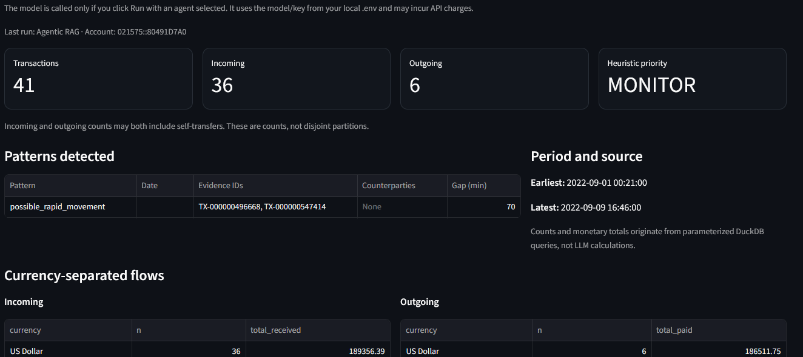
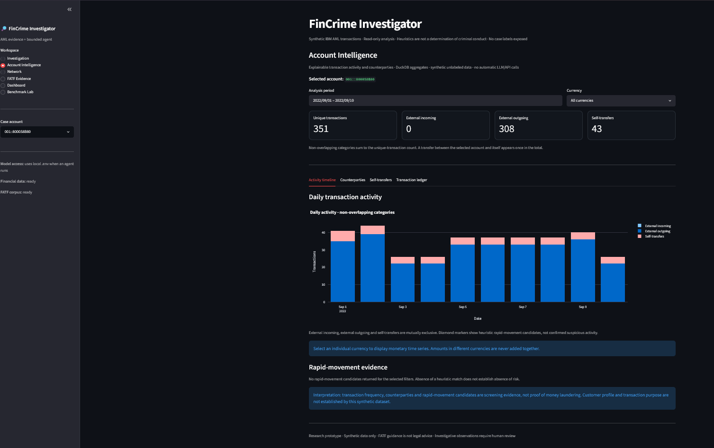
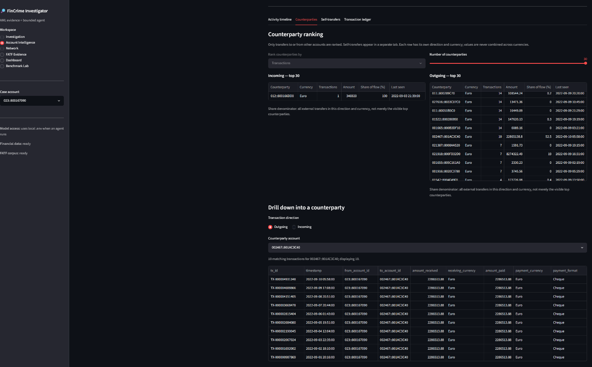
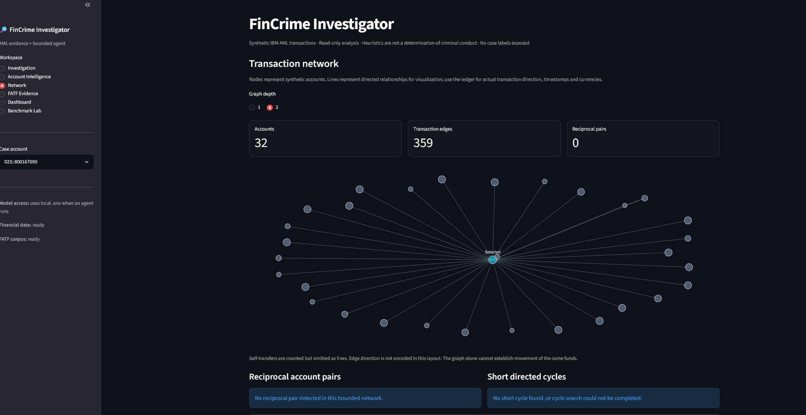
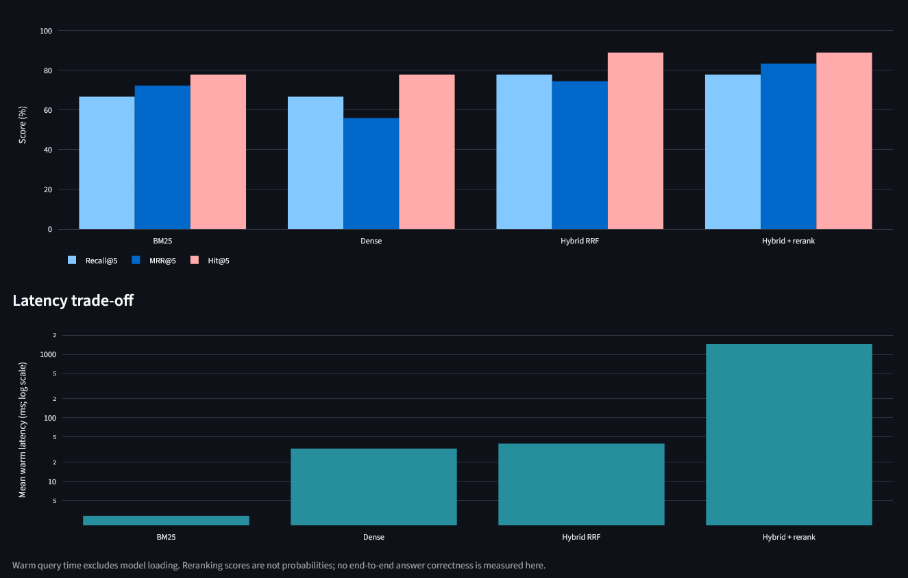
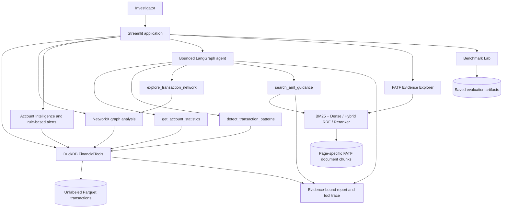

# FinCrime Investigator

**An explainable, evidence-grounded anti-money-laundering investigation prototype.**

FinCrime Investigator combines **DuckDB analytics**, **NetworkX transaction graphs**, **FATF document retrieval (RAG)**, and a **bounded LangGraph agent** in a local **Streamlit** application. It investigates account activity in the **synthetic IBM AMLworld HI-Small dataset**, identifies transparent review indicators, and produces reports linked to transaction records and regulatory guidance.

> **Scope:** Research and decision-support prototype, not a production AML monitoring system. An alert or model narrative is **not** proof of money laundering. All transaction data used here is synthetic.

**Project:** Ironhack AI & Machine Learning bootcamp final project

**Repository:** [JohnWCM/fincrime-investigator](https://github.com/JohnWCM/fincrime-investigator)
**Stack:** Python · Streamlit · DuckDB · Parquet · NetworkX · LangGraph · BM25 · SentenceTransformers · ChromaDB · Cross-encoder reranking · Plotly

## At a glance

| Capability | Implementation |
| --- | --- |
| Exact financial facts | Parameterized DuckDB queries; currency-separated totals and non-overlapping transaction categories |
| Transaction networks | Bounded 1-hop and 2-hop NetworkX exploration; reciprocal links and short-cycle checks |
| Screening indicators | Rapid movement, repeated identical payments, counterparty concentration and other explicit heuristics |
| FATF evidence search | BM25, dense embeddings, reciprocal-rank-fusion hybrid, optional cross-encoder reranking |
| Agent investigation | LangGraph tools for account statistics, patterns, networks and FATF guidance; explicit tool-call budget |
| Auditability | Transaction IDs, PDF page/chunk references, tool trace, downloadable JSON/CSV |
| Evaluation | Retrieval dev/test experiments, agent regression and account-disjoint SQL-grounded benchmark |
| Automated checks | **34 passing tests** on the project's local test run (12 November 2026) |

## Screenshots

**Investigation workspace:** SQL-backed statistics, pattern findings and an agent-authored explanation.



<details>
<summary>Additional screenshots — activity timeline, counterparty drill-down, network and retrieval benchmark</summary>

**Account Intelligence — transaction timeline**



**Counterparty analysis and transaction evidence**



**Bounded transaction network**



**FATF retrieval benchmark**



</details>

*Screenshots show individual local runs. The network screenshot is an example of the general network interface; the separately validated two-hop demonstration is described below.*

## System architecture



**Division of responsibility:** SQL calculates counts and monetary aggregates; NetworkX summarizes relationships; retrieval supplies source text; the LLM drafts a contextual interpretation. The agent should not invent numerical evidence or treat a FATF indicator as an account-specific finding.

## Features and example investigations

### Investigation workspace

Choose a **Deterministic baseline**, **Tools-only agent**, or **Agentic RAG** investigation. The result includes account totals, currency-separated flows, pattern evidence, investigation period, citations and a tool trace. Agent calls run **only after** clicking *Run investigation*, and require a locally configured API key.

An end-to-end example is account `021575::80491D7A0`: **41** unique transactions, **36** incoming, **6** outgoing and a possible rapid-movement pairing **70 minutes** apart. The tool trace in the reviewed run contained `get_account_statistics`, `detect_transaction_patterns`, `explore_transaction_network` and `search_aml_guidance`. These are observations about synthetic data, not determinations of illicit conduct.

### Account Intelligence

The Account Intelligence workspace provides:

- **Activity timeline:** filtered daily activity, with external incoming, external outgoing and self-transfers shown separately.
- **Counterparty analysis:** ranking by transaction count or transferred value, separated by direction and currency, with transaction-level drill-down.
- **Self-transfer analysis:** including same-account transactions with different payment and receiving currencies.
- **Transaction ledger:** timestamps, transaction IDs, accounts, payment formats and CSV export.
- **Pattern alerts:** rule-based repeated-payment detection and counterparty-concentration indicators, both linked to their supporting transactions.

Example: account `023::800167090` has **272** unique transactions, including **271 external outgoing** and **1 external incoming** transaction in the evaluated subset. Its counterparty drill-down displayed **ten identical outgoing EUR payments of €228,651.38** to `002467::801AC3C40`, a total of **€2,286,513.80**, approximately **52.5%** of its outgoing EUR value. These findings warrant contextual review; repetition or concentration alone does not establish misconduct.

Account `001::800058B80` illustrates the need to avoid double-counting: **351** unique transactions include **308 external outgoing** and **43 self-transfers** (23 USD→USD and 20 USD→EUR).

### Transaction network

The Network view exposes configurable **graph depth 1 or 2**, bounded edge retrieval, reciprocal relationships and directed-cycle checks. A separate demo subset provides a genuine two-hop network for `00701::800A8E530`: discovery found **5 nodes at one hop** and **38 at two hops** (**33 additional nodes**, **59 transaction edges**). The extra nodes come from complete, bounded counterparty-neighborhood data, not fabricated links.

The graph is a visualization of the selected subset; lines in the current layout do **not** encode actual payment direction. Use the transaction ledger for directional, timestamp and currency evidence.

### FATF Evidence Explorer

Search the indexed FATF guidance with BM25, dense vector search, **Hybrid RRF** or Hybrid plus cross-encoder reranking. Results show document titles, PDF pages, stable chunk IDs and links to source publications. The local corpus in the evaluated build contains **323 chunks across three documents**.

## Evaluation

Evaluation methods and denominators matter: the benchmarks below assess **retrieval** and **exact SQL-grounded question answering**, not money-laundering detection precision or recall.

### 1. FATF passage retrieval

Each method retrieves five passages per question. Metrics use manually annotated supporting chunks. Development has **9 questions** and the held-out test has **3**; both samples are small.

| Method | Dev Recall@5 | Dev MRR@5 | Dev Hit@5 | Dev mean warm latency |
| --- | ---: | ---: | ---: | ---: |
| BM25 | 66.67% | 0.7222 | 77.78% | 2.85 ms |
| Dense | 66.67% | 0.5593 | 77.78% | 32.74 ms |
| **Hybrid RRF** | **77.78%** | 0.7444 | **88.89%** | 39.20 ms |
| Hybrid + rerank | **77.78%** | **0.8333** | **88.89%** | 1,458.13 ms |

| Method | Test Recall@5 | Test MRR@5 | Test Hit@5 | Test mean warm latency |
| --- | ---: | ---: | ---: | ---: |
| BM25 | **100%** | 0.8333 | 100% | **2.46 ms** |
| Dense | 66.67% | 0.3444 | 100% | 467.59 ms |
| **Hybrid RRF** | 83.33% | **1.0000** | 100% | 32.52 ms |
| Hybrid + rerank | 83.33% | **1.0000** | 100% | 760.41 ms |

**Decision:** Hybrid RRF is the default based on development-set coverage/ranking and interactive latency. BM25 remains a fast alternative. Reranking improved development MRR but added significant latency; on the three test questions it did not improve ranking over Hybrid. The three-question test is far too small to establish universal superiority. Dense test mean latency includes a high-latency outlier relative to its median.

### 2. LangGraph numerical regression

The initial agent relied on a truncated transaction listing for some exact questions. Exposing `get_account_statistics` as a DuckDB aggregate tool resolved the **three previously failed development questions** for both agent architectures:

| Targeted exact-answer regression | Before tool fix | After tool fix |
| --- | ---: | ---: |
| Tools-only | 0/3 | **3/3** |
| Agentic RAG | 0/3 | **3/3** |

These are *targeted regression cases*, not an overall agent accuracy estimate.

### 3. Expanded, account-disjoint SQL benchmark

Eight additional accounts were checked for complete direct transaction histories against the unlabeled source. Six accounts were used for development (**24 questions**), and two entirely different accounts for held-out testing (**8 questions**). Four deterministic question types were used per account: unique transaction count, incoming count, outgoing count and latest timestamp.

| Split | Tools-only | Agentic RAG |
| --- | ---: | ---: |
| Development: 24 questions | **24/24 correct** | **24/24 correct** |
| Held-out: 8 questions | **8/8 correct** | **8/8 correct** |
| Total | **32/32** | **32/32** |

**64/64 correct responses** is a descriptive result for these specific SQL-grounded tasks. The evaluation **forces the account-statistics tool to be available and called first**; it does not test autonomous tool choice, calibrated risk scoring, general AML detection, or generated citation correctness. Evidence faithfulness is a separate human-review criterion and must not be inferred from matching numbers alone.

Saved local metrics are read by Streamlit's **Benchmark Lab**. The initial exploratory 39-response QA study has different task coverage across architectures and should not be treated as a matched-head-to-head accuracy ranking.

## Run locally

The app is designed to run locally with a separately downloaded synthetic dataset and a local `.env` file. These setup steps are for **Windows PowerShell** from the repository root.

### 1. Clone and install

Use a compatible Python environment (Python **3.11** is a conservative starting point for the pinned package families):

```powershell
git clone https://github.com/JohnWCM/fincrime-investigator.git
cd fincrime-investigator
py -3.11 -m venv .venv
.\.venv\Scripts\Activate.ps1
python -m pip install --upgrade pip
python -m pip install -r requirements.txt
```

If `requirements-agent.txt` exists in the checked-out project, install it too to get the LangGraph/OpenAI integration versions:

```powershell
python -m pip install -r requirements-agent.txt
```

> Dependency versions should be validated in a fresh environment before release. Do not commit the virtual environment or API credentials.

### 2. Download and prepare synthetic transactions

Download `HI-Small_Trans.csv` from the [IBM AML dataset on Kaggle](https://www.kaggle.com/datasets/ealtman2019/ibm-transactions-for-anti-money-laundering-aml) and save it to:

```text
data/raw/HI-Small_Trans.csv
```

Then run:

```powershell
python -m src.ingest
python -m src.prepare_data
```

This generates the unlabeled Parquet transaction data and the original selected investigation subset. The source CSV's `Is Laundering` label is separated into evaluation-only storage and must not be given to the agent or Streamlit inference features.

To reproduce the expanded accounts and the bounded two-hop demo, run **once per output dataset**:

```powershell
python scripts/expand_demo_cases.py --apply
python -m scripts.create_two_hop_demo --account 00701::800A8E530 --apply
```

These scripts write new Parquet files and manifests and refuse to overwrite their existing outputs. The two-hop builder must run with `python -m ...` so that Python can import `src` from the repository root.

### 3. Build the FATF knowledge base

```powershell
python -m src.rag download
python -m src.rag ingest
python -m src.rag build-dense
```

If automated PDF downloading fails, obtain the three PDFs from the official FATF pages linked below and save them under the filenames expected in `data/raw/fatf/`. First-time embedding/reranker runs may download model weights and require an internet connection.

### 4. Configure the agent (optional for deterministic features)

Create a local `.env` file, **never commit it**:

```dotenv
OPENAI_API_KEY=your_api_key_here
OPENAI_MODEL=your_enabled_model_name
```

The agent code reads `OPENAI_MODEL` (falling back to its configured default). The available model depends on your own API access; API calls may incur charges. Do **not** put keys in source code, notebooks, screenshots or Git history.

### 5. Select the dataset and launch Streamlit

The working application can use the selected baseline, expanded or two-hop dataset. In `app/streamlit_app.py`, make `SUBSET` and `MANIFEST` point to matching files. For the two-hop demonstration:

```python
SUBSET = ROOT / "data/processed/investigation_subset_2hop_demo.parquet"
MANIFEST = ROOT / "data/processed/subset_manifest_2hop_demo.json"
```

Launch:

```powershell
python -m streamlit run app/streamlit_app.py
```

Open the local address shown in the terminal (normally `http://localhost:8501`). If another Streamlit session is already running, use `--server.port 8502`. A fresh Streamlit process may be needed after installing new Python modules.

### 6. Tests and reproducible evaluations

```powershell
python -m pytest -q
```

The last reported local run passed **34 tests**; 50 non-blocking Python `sqlite3` datetime-adapter deprecation warnings were emitted by test fixtures.

To rescore **existing** annotations and predictions without initiating model runs:

```powershell
python -m src.benchmark_retrieval score --split dev
python -m src.benchmark_retrieval score --split test
python scripts/benchmark_expanded.py score --split dev
python scripts/benchmark_expanded.py score --split test
```

Original evaluation data, gold annotations and metrics live under `data/evaluation/`. Those files are local/generated by default and may not be included in the public repository. To reproduce the benchmark from scratch, follow the guides in `docs/` and manually verify/grade supporting evidence. Avoid overwriting previous test results.

## Repository structure

```text
fincrime-investigator/
├── app/
│   ├── streamlit_app.py           # Streamlit entry point / workspaces
│   ├── account_intelligence.py    # Account Intelligence UI
│   ├── intelligence_data.py       # Account-level SQL aggregations
│   ├── intelligence_alerts.py     # Pattern detection / evidence queries
│   ├── intelligence_alerts_view.py
│   └── ui_helpers.py
├── src/
│   ├── ingest.py / prepare_data.py
│   ├── functions.py / baseline.py / graph.py
│   ├── rag.py / retrieval_advanced.py
│   ├── agent.py / tools_only_agent.py
│   └── benchmark_*.py
├── scripts/
│   ├── expand_demo_cases.py
│   ├── create_two_hop_demo.py
│   └── benchmark_expanded.py
├── data/
│   ├── raw/                     # Downloaded synthetic source; not in Git
│   ├── processed/               # Generated Parquet/indexes; not in Git
│   └── evaluation/              # Local labels, annotations, predictions, metrics
├── docs/
│   └── screenshots/             # Images used in this README
├── tests/
├── requirements.txt
└── README.md
```

Other project files include notebooks, evaluation protocols, installation notes and source documentation. Some generated folders are intentionally absent from Git because they contain large or separately licensed data.

## Responsible use and limitations

- **Synthetic only:** This project does not validate performance on real financial institutions' transactions.
- **Selected cases:** Demo subsets are not representative of the full data distribution; they cannot support claims about population precision, recall or prevalence.
- **No leakage into inference:** The original transaction labels are stored separately from the data read by the application and agent.
- **Not evidence of guilt:** Large payments, self-transfers, concentration, unusual routing and rapid movements are screening indicators requiring customer context and independent inquiry.
- **No FX netting:** Payment and receiving amounts are separated by currency; cross-currency values must not be added together without verified conversion rates.
- **Graph boundaries:** Two-hop completeness is established for the selected bounded demonstration case, not for every account or the full IBM graph.
- **Retrieval limitations:** A retrieved source is general guidance, not a finding about the account. The annotation sample is small and was constructed with access to candidate retrievals, creating possible annotation bias.
- **Older legal guidance:** The FATF's **2014 banking-sector guidance** predates later revisions of the FATF Recommendations, including Recommendation 1 changes in 2025. This prototype is not a source of up-to-date legal advice.
- **Human review:** LLM commentary is explicitly unverified; investigators should check claims against transaction IDs, original source pages and lawful contextual data.
- **Operational limits:** No production authentication, regulatory audit certification, live bank feeds or calibrated AML risk model. Model costs and latency depend on the environment.

## Data and reference sources

- [IBM AML-Data](https://github.com/IBM/AML-Data) and [Kaggle: IBM Transactions for Anti Money Laundering](https://www.kaggle.com/datasets/ealtman2019/ibm-transactions-for-anti-money-laundering-aml). IBM distinguishes its repository code licensing from **CDLA-Sharing-1.0** terms for the dataset. Check the original license before redistribution.
- [FATF — Guidance for a Risk-Based Approach: The Banking Sector (2014)](https://www.fatf-gafi.org/en/publications/fatfrecommendations/documents/risk-based-approach-banking-sector.html).
- [FATF — Trade-Based Money Laundering: Risk Indicators (2021)](https://www.fatf-gafi.org/en/publications/Methodsandtrends/Trade-based-money-laundering-indicators.html).
- [FATF — Operational Issues: Financial Investigations Guidance (2012)](https://www.fatf-gafi.org/en/publications/Methodsandtrends/Operationalissues-financialinvestigationsguidance.html).

The dataset and FATF PDFs are third-party materials subject to their own terms. See `docs/sources.md` for the original source register and caveats.

---

**FinCrime Investigator is an educational prototype for explainable investigation workflows—not a tool for declaring financial-crime liability.**
